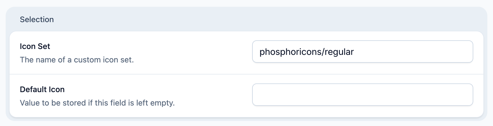

# Statamic Phosphoricons

> Statamic Phosphoricons allows you to use the Phosphoricons library as set icons within the CP.

## Features

- use all 1500+ Phosphor icons within the CP
- choose from 6 icon variants including fill and duotone

See the Phosphoricons [website](https://phosphoricons.com/) for reference.

## How to Install

You can install this addon via Composer:

```bash
composer require schantldev/statamic-phosphoricons
```

To set a different variant than the default `light` variant, publish the `phosphoricons.php` configuration file using `php artisan vendor:publish --tag phosphoricons-config` and set a different variant instead. Optionally, you can disable the usage as set icons, by setting the variant to ``null``. The default Statamic icons will then be used instead.

By default, the addon will symlink all the icons from the vendor folder. If you have concerns doing so, feel free to publish all icons (over 9,000 SVGs) by running `php artisan vendor:publish --tag phosphoricons-assets`.

## How to Use

Whenever the CP offers you to choose an icon, for example in in the blueprint builder, you can now select from all the available Phosphoricons.

### Usage with the ``Icon`` fieldtype
The icon set option should be set to: ``phosphoricons/{variant}``, while variant can be ``regular``, ``thin``, ``light``, ``bold``, ``duotone`` or ``fill``.




## Developer Note for contributing

When updating the phosphoricons library, adjust the version in the `package.json` if necessary and run `npm update`. Furthermore, run `npm run export` to copy all the icons to the `assets` folder, followed by `npm run rename` to rename the icons accordingly.

This is necessary, because the icons always include the variant name at the end. Renaming them allows for switching variants without reselecting them.

The renaming command relies on the Perl `rename` library. Install via `brew install rename`.
